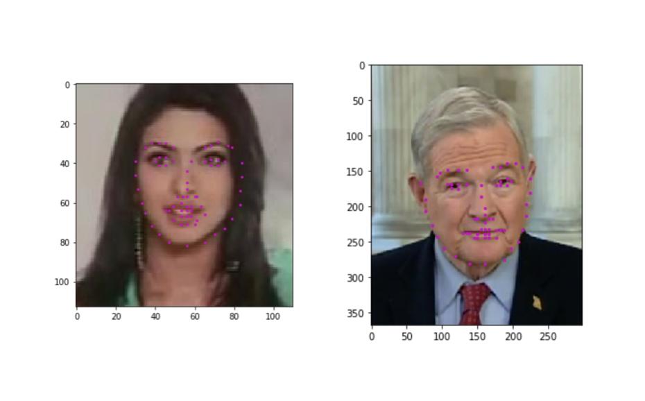
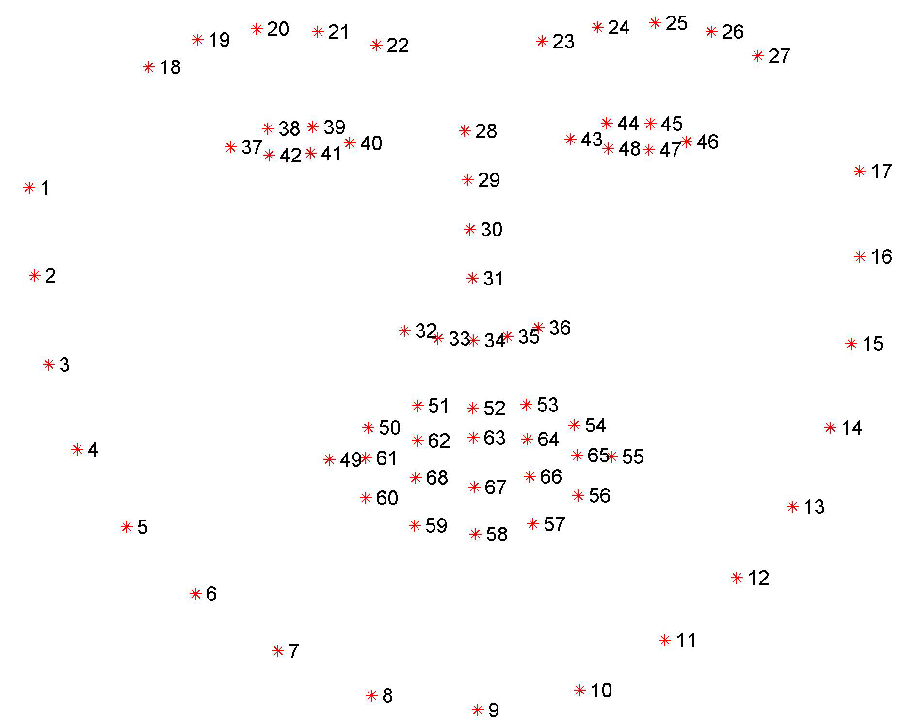

# Facial Keypoint Detection

A computer vision project that detects **68 facial keypoints** (eyes, eyebrows, nose,
mouth and jawline) on any face in an image. It combines a classic OpenCV Haar cascade
face detector with a **convolutional neural network (CNN)** built in PyTorch, and uses
the predicted keypoints to overlay fun filters (sunglasses, moustache, etc.).

This was my final project for the [Udacity Computer Vision Nanodegree](https://www.udacity.com/course/computer-vision-nanodegree--nd891).

<p align="center">
  
  
</p>

## How it works

The full pipeline (notebook 3) runs in three steps:

1. **Face detection** — an OpenCV Haar cascade finds the bounding box of each face.
2. **Preprocessing** — each face is cropped, converted to grayscale, rescaled to
   224×224 and normalized.
3. **Keypoint regression** — the CNN predicts 136 values (an `(x, y)` pair for each of
   the 68 landmarks), which are then rescaled back to the original image.

### Model architecture (`models.py`)

A simple CNN that takes a 224×224 grayscale image and regresses 136 coordinates:

| Layer      | Detail                                   |
|------------|------------------------------------------|
| Conv1      | 1 → 32 channels, 5×5 kernel, ReLU + MaxPool |
| Conv2      | 32 → 64 channels, 3×3 kernel, ReLU + MaxPool |
| Conv3      | 64 → 128 channels, 3×3 kernel, ReLU + MaxPool |
| FC1        | 128·26·26 → 512, ReLU + Dropout(0.3)     |
| FC2        | 512 → 136 (68 keypoints × 2)             |

**Training:** Adam optimizer (`lr = 5e-4`), MSE loss, batch size 10. Data augmentation
via `Rescale(250) → RandomCrop(224) → Normalize → ToTensor`.

## Repository structure

```
.
├── 1. Load and Visualize Data.ipynb          # Dataset exploration & transforms
├── 2. Define the Network Architecture.ipynb  # Build, train and save the CNN
├── 3. Facial Keypoint Detection, Complete Pipeline.ipynb  # End-to-end detection
├── 4. Fun with Keypoints.ipynb               # Overlay filters using keypoints
├── models.py                                 # CNN definition (Net)
├── data_load.py                              # Dataset class & image transforms
├── detector_architectures/                   # Pre-trained Haar cascade XMLs
├── images/                                    # Example & filter images
└── requirements.txt
```

## Getting started

```bash
# 1. Install dependencies
pip install -r requirements.txt

# 2. Launch Jupyter
jupyter notebook
```

Run the notebooks in order (1 → 4). **Notebook 1 automatically downloads the dataset**
(~5,770 training / 2,308 test images from the [YouTube Faces Dataset](https://www.cs.tau.ac.il/~wolf/ytfaces/))
from Udacity's public S3 bucket into a `data/` folder.

> **Note on the trained model:** the saved weights (`saved_models/keypoints_model_1.pt`,
> ~170 MB) are **not** committed to this repo because they exceed GitHub's 100 MB file
> limit. Re-create them by running **notebook 2**, which trains the network and saves the
> checkpoint to `saved_models/`.

## Results

See the rendered notebooks for visual results — predicted keypoints on test faces, the
complete detection pipeline on group photos (the Beatles, the Obamas), and the filter
overlays in notebook 4.

## Acknowledgements

Project scaffolding, dataset and starter code are provided by the
[Udacity Computer Vision Nanodegree](https://github.com/udacity/P1_Facial_Keypoints).
The network architecture, training and completed pipeline are my own work.
